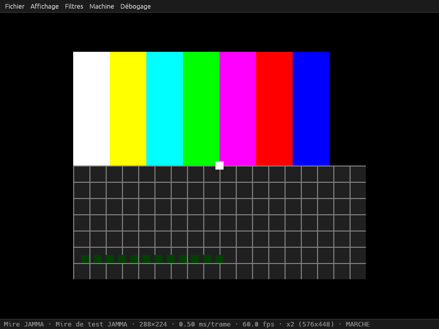
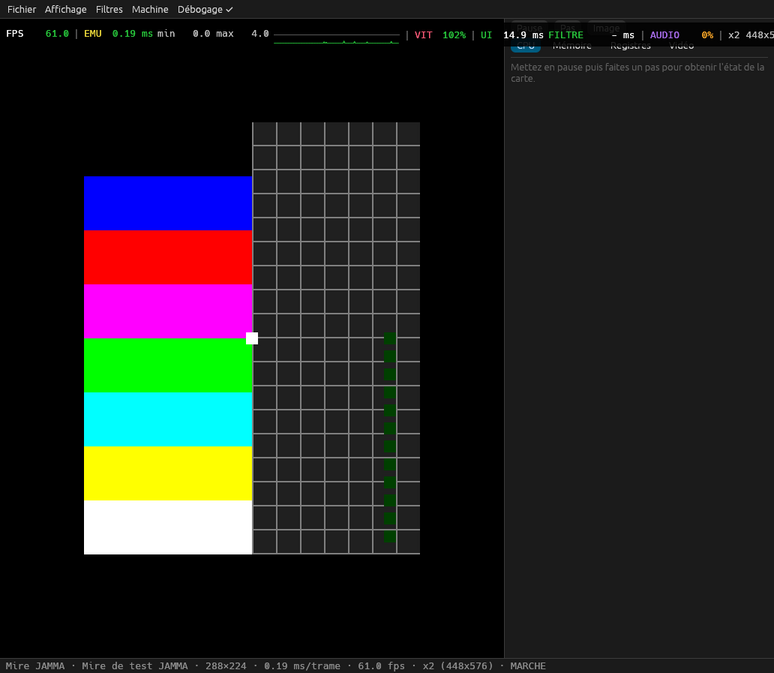

# PuceArcade JammaGui Crates

Le « connecteur JAMMA » en Rust : un contrat unique entre une carte d'arcade émulée et un frontal, comme le connecteur des bornes
qui accepte n'importe quelle carte.

| Crate | Rôle |
|---|---|
| `puce-jamma` | contrat : `JammaBoard` (vidéo, son, commandes 4 joueurs × 6 boutons, pièces, service, test, tilt, analogique, DIP décrits, savestates, débogage optionnel) et `BoardDriver` (catalogue, chargement). Aucune dépendance. |
| `puce-jamma-testboard` | carte de test (mire, curseur, bip, DIP) pour développer et tester les frontaux. |
| `puce-jamma-gui` | frontal egui réutilisable, repris du GUI de Puce16 Neo Geo : scalers 2x (HQ2X, Eagle, 2xSaI, Scale2x…), filtres CRT (scanlines, masques, canaux RVB, convergence, barre de balayage), overlay de performances, son cpal, clavier et manettes, menus DIP générés, savestates, captures, débogueur générique. |

Contrat : `docs/spec/00-contrat-jamma.md`. Développement par cartes Hermes Kanban (`tasks/`, `scripts/kanban_import.ps1`, board « jamma »), méthode de Puce16 Neo Geo.
Premier utilisateur : [PuceArcade CPS1](https://github.com/Farquaad56/PuceArcade_CPS1) (épingle une révision git).





## Essayer

```
cargo run -p puce-jamma-gui --example testboard --release
```

Brancher son émulateur : `docs/INTEGRATION.md`.

## Commandes par défaut (modifiables dans Machine > Commandes)

| | Joueur 1 | Joueur 2 | Manette n -> joueur n |
|---|---|---|---|
| Directions | flèches | I / K / J / L | croix ou stick gauche |
| Boutons 1 à 6 | Z X A S Q W | G H T Y U O | South East West North LeftTrigger RightTrigger |
| Start | Entrée | P | Start |
| Pièce | 5 (pièces 1-4 : 5 6 7 8) | 6 | Select |

Service : 9 ; Test : F2 ; Tilt : aucune touche. Joueurs 3 et 4 : manettes 3 et 4 (aucune touche par défaut).

## Raccourcis

| Touche | Action |
|---|---|
| F3 | réinitialiser |
| Ctrl+P | pause (P seul est le Start du joueur 2) |
| F6 | avance d'une image (en pause) |
| F5 / F7 | sauver / charger l'état de l'emplacement courant |
| F8 | emplacement suivant (0 à 9) |
| F11, Échap | plein écran / quitter le plein écran |
| F12 | capture PNG (image native tournée) dans le dossier des sauvegardes |
| Ctrl+B | bezels en plein écran (activer / désactiver) |
| Ctrl+M | mires de réglage (afficher / quitter) |
| Page préc. / Page suiv. | mire précédente / suivante (mires affichées) |
| Ctrl + Page préc. / suiv. | variante de la mire |
| Ctrl+H | masquer / montrer le panneau des mires |

## Ouvrir un jeu

Fichier > Ouvrir un jeu : filtre par texte, par disponibilité des ROM et par catégorie. Code couleur : blanc pour
les originaux, bleu pour les clones officiels (régions, révisions), orange pour les bootlegs, magenta pour les
hacks, jaune pour les prototypes. « Commerciaux seulement » ne garde que les originaux et les clones officiels.
La catégorie vient du driver (`GameEntry::kind`, règle commune `GameKind::from_mame`).

## Filtres vidéo

Menu Affichage > Filtres vidéo. Préréglages : Moniteur d'arcade 15 kHz, Sony Trinitron, Tube fané. Onglets :
- **Image** : agrandissement pixel art, interpolation horizontale, overscan ;
- **Lignes et masque** : scanlines (standard, adaptatives, faisceau gaussien), masque (fentes, points, Trinitron,
  tube fané) ;
- **Couleur** : gamma, niveau du noir, température du blanc (9 300 K = moniteur japonais), canaux RVB ;
- **Tube** : courbure, vignettage, coins arrondis (sans effet quand un bezel est affiché), halo, convergence ;
- **Effets** : barre de balayage, instabilité, taches de pureté, images noires (écran 120 Hz ou plus).

## Mires de réglage

Bouton « Mires » de la barre de menus, ou Ctrl+M : la mire remplace l'image du jeu, à sa définition et
dans son orientation (320 × 240 sans jeu), et passe par les filtres et le bezel. Le jeu est mis en pause
pendant les mires (désactivable). Mires : géométrie (grille et cercles), convergence (points, croix, grille
fine), overscan (cadres de 0 à 10 %), barres de couleur (75 % et 100 %), pureté (aplats rouge, vert, bleu,
blanc, gris, noir), contraste, luminosité (noirs à 2, 5 et 10 %), dégradés RVB, gamma (1.8, 2.2, 2.5),
netteté (rayures de 1 à 4 px), mouvement. Le panneau rappelle ce que chaque mire permet de régler.
L'exemple `mires` les enregistre en PNG.

## Bezels (plein écran)

Le frontal affiche en plein écran les bezels au format RetroArch : un fichier `<jeu>.cfg` (ligne
`overlay0_overlay = image.png`) et son image PNG, dans le dossier `bezels_dir` passé à `AppOptions`.
Recherche : le jeu, puis son parent, puis `_generic.cfg`. L'écran du bezel est la zone où l'alpha est
inférieur à 128 autour du centre ; l'image du jeu le remplit si ses proportions sont à moins de 5 %, sinon
elle y est centrée. La vitre semi-transparente du bezel (reflets) est dessinée par-dessus le jeu. Elle se désactive par la case « Reflets de la vitre » du menu Affichage.
Case « Bezels en plein écran » dans le menu Affichage, ou Ctrl+B ; le choix est gardé dans `prefs.toml`.

## Licence

Projet d'émulateur en Rust par **Le Garrec Sebastien**. Licence **PuceArcade — usage non commercial, tous droits
réservés** (fichier [`LICENSE`](LICENSE)) : usage personnel, éducatif et de recherche gratuit, copies non modifiées
redistribuables gratuitement ; tout usage commercial, toute version modifiée distribuée et toute intégration dans un
autre produit demandent l'accord écrit de l'auteur. Les parties issues de tiers (données de filtres MiSTer, dossier `ref/`) restent sous leur propre
licence. Les versions publiées avant le 24 novembre 2026 restaient sous licence MIT.
